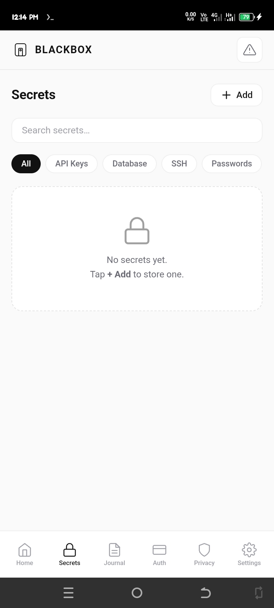
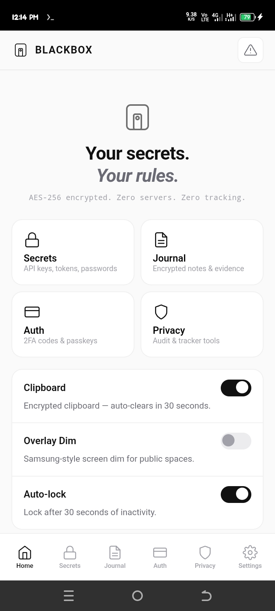

# BLACKBOX 🔒

<div align="center">

[](LICENSE)
[](https://developer.android.com)
[](https://csrc.nist.gov/publications/detail/fips/197/final)
[](https://f-droid.org/packages/com.blackbox.app/)

**BLACKBOX** is an offline, security-first hub for developers and creators. Featuring an encrypted secrets manager, private journal, 2FA authenticator, and comprehensive privacy tools, BLACKBOX ensures 100% on-device processing and zero cloud exposure.

[Report Bug](https://github.com/alpha-1-design/BLACKBOX/issues) · [Install from F-Droid](https://f-droid.org/packages/com.blackbox.app/) · [Contributing](./CONTRIBUTING.md)

<div align="center">
  
  
</div>

</div>

---

## 🚀 Key Features

*   **Secrets Manager:** Store API keys, tokens and credentials in an AES-256-GCM vault with sorting, reveal-on-demand and read-first details.
*   **Encrypted Journal:** Timestamped entries with moods, tags, templates, calendar/day filter, sorting and encrypted photo attachments.
*   **TOTP Authenticator:** RFC 6238 codes with SHA-1/SHA-256/SHA-512, custom digit counts and periods, and `otpauth://` import.
*   **Privacy Toolkit:** URL tracker stripping, browser fingerprinting analysis and phishing detection.
*   **Hardened Security:** PBKDF2 PIN verifier, atomic PIN changes, configurable auto-lock, manual lock, `FLAG_SECURE`, biometric unlock, shake-to-lock and a calculator decoy mode.

---

## 🏗️ Technical Architecture

BLACKBOX is engineered for high-assurance privacy:
*   **Encryption:** AES-256-GCM using Web Crypto API.
*   **Key Derivation:** PBKDF2-SHA256 with 150,000 iterations.
*   **Storage:** 100% localized in `localStorage` (encrypted blobs); no network traffic or cloud sync.
*   **Native Integration:** Android-native implementation via Capacitor for biometric security and overlay protection.

---

## 🛠️ Quick Start (Development)

```bash
# Clone the repository
git clone https://github.com/alpha-1-design/BLACKBOX.git
cd BLACKBOX

# Install dependencies
npm install

# Initialize Capacitor
npx cap init BLACKBOX com.blackbox.app --web-dir www

# Add Android platform and build
npx cap add android
npx cap sync android
cd android && ./gradlew assembleDebug
```

---

## ✅ Verification

The dependency-free suite covers crypto, decoy isolation, TOTP vectors, UI contracts, boot order, the lock-screen state machine and the voice recorder:

```bash
npm test
```

Browser end-to-end scripts need Python 3 with Playwright and a local server:

```bash
python -m http.server 8765 --bind 127.0.0.1 --directory www
python ci/browser-check.py
python ci/e2e-flow.py
python ci/e2e-all.py
python ci/e2e-picker-welcome.py
```

They drive first-run setup, every tab, PIN change, decoy lock, file/camera pickers, welcome-back and manual lock through real Chrome.

---

## 🔒 Security Model

BLACKBOX assumes a "Zero-Trust" posture:
1.  **Fresh Derivation:** The master key is derived from your PIN with PBKDF2-SHA256 (150,000 iterations) and dropped from module state on lock. A session copy is retained only to allow biometric re-auth; **Clear All Data** wipes it.
2.  **No Persistence of Secrets:** Your PIN is never stored. A salted PBKDF2 verifier validates it, and legacy plaintext/SHA-256 verifiers are migrated to that format on first unlock.
3.  **Tamper Detection:** AES-256-GCM provides authenticated encryption, so modified ciphertext fails to decrypt instead of yielding corrupted plaintext.
4.  **Lock Is a Real Boundary:** Locking closes every overlay, clears text-bearing form controls, and purges decrypted secret, journal, file and 2FA caches — codes in the DOM return to `------`.

---

## 📜 Contributing & Community

We are committed to building the most robust privacy toolset in the ecosystem. Please see our [Contributing Guide](./CONTRIBUTING.md) and [Code of Conduct](./CODE_OF_CONDUCT.md).

Distributed under the **MIT License**. Built for the Alpha-1 Ecosystem.
